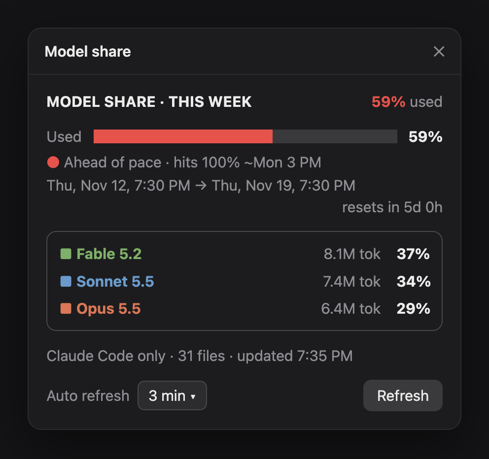

# model-share

A [Claude Code](https://claude.com/claude-code) mod that shows **which models your weekly usage went to**, in a pane beside the chat.

Think of your week like distance driven: if you've driven 10 km, how much of it was by car, bike or truck? Here, everything you used this week is 100%, and each model gets its share.

<p align="center">
  
</p>

```
/plugin install model-share --marketplace shubhamverma8991/claude-model-share
```

## What it shows

- **Weekly limit used** — the same "7-day" figure Claude Code reports, as a bar colored by pace:
  green when you're using it no faster than the week is passing, amber when slightly ahead, red when you'd run out more than a day before the reset. The line under it says when you'd hit 100% at this rate.
- **Your weekly window** — when it started and when it resets (it follows your plan's 7-day reset, e.g. Thursday 7:30 PM to Thursday 7:30 PM), and resets with it.
- **Share per model** — each model's share of everything you used this week (adding up to 100%), with its token count.
- **Status line** — a one-line summary under the prompt: `This week (59% used): Fable 37% · Sonnet 34% · Opus 29%`.

It works in the Claude Code terminal, the Claude desktop app's Code tab and the VS Code extension.

## Install

Requirements: a recent Claude Code with mod support (function hooks), and `python3` on your `PATH` (preinstalled on most macOS and Linux systems).

At the prompt of a Claude Code terminal session:

```
/plugin install model-share --marketplace shubhamverma8991/claude-model-share
```

Answer `y` to add the marketplace, then press Enter to install for your user. The pane opens in that session right away and in every session after.

From a shell instead:

```bash
claude plugin install model-share --marketplace shubhamverma8991/claude-model-share
```

In the Claude desktop app (where `/plugin` doesn't run): click **+** next to the prompt box → **Plugins** → **Add marketplace** → `shubhamverma8991/claude-model-share`, then **Add plugin**.

### Update

```bash
claude plugin update model-share
```

then run `/reload-plugins` in an open session (or start a new one).

### Uninstall

```bash
claude plugin uninstall model-share
```

## Use

- The **Model share** pane opens on its own when a session starts. Closed it? Type `/model-share`.
- **Refresh** recounts now.
- **Auto refresh** picks how often it recounts while a session is open: 1, 3 (default), 5 or 10 minutes, or Off. Your choice is remembered across sessions.
- Or by command: `/model-share every 5m` (also `every 90s`, `every off`; 30 seconds at least).

It also recounts after every Claude reply and whenever your weekly limit figure changes.

## How it works

Claude Code saves each session as a file under `~/.claude/projects/` (or `$CLAUDE_CONFIG_DIR/projects/`), and every reply in it records the model and the tokens it used. The mod runs a small Python script ([`hooks/scan.py`](hooks/scan.py)) that reads this week's session files — all projects, subagents included — counts each reply once, and adds up the tokens per model. The weekly window and limit come from Claude Code itself.

- **No tokens used.** Refreshing only reads local files; it never calls a model.
- **Fast.** A recount takes a fraction of a second.

## Privacy and what the mod does on your computer

**The one program it runs.** The mod starts exactly one program, and only this command:

```
python3 -I <plugin folder>/hooks/scan.py <week start>
```

`hooks/scan.py` is the script in this repository. Its only argument is the start of your weekly window (a number, or `auto`), and it runs in Python's isolated mode (`-I`). The mod starts it when a session opens, after each Claude reply, when your weekly limit figure changes, on **Refresh**, and on the auto-refresh timer. It never runs any other program and never runs code it downloads.

**What it reads.** Your Claude Code session files under `~/.claude/projects/` (or `$CLAUDE_CONFIG_DIR/projects/`). These files hold your conversations. The script reads only the records of Claude's replies, and from each one keeps only the model name, the four token counts, the timestamp and the reply's ID (to count each reply once). It never keeps, prints or passes on message text. It prints one small JSON result: total tokens per model and the number of files read. The mod also reads your weekly limit figure from Claude Code.

**What it sends.** Nothing. The mod makes no network requests and sends no data anywhere. What it works out is shown only on your screen, in its pane and the status line.

**What it stores.** Two values in Claude Code's own per-plugin storage on your computer: your auto-refresh choice, and the last weekly limit % a session saw (so clients that don't receive it, like the VS Code extension, can still show it).

**What it hooks.** The mod adds a pane, a status line and one command. It doesn't change your prompts, Claude's replies or any tool call:

| Hook | What it does |
| --- | --- |
| `session.start` | Registers `/model-share`, opens the pane, starts the auto-refresh timer, counts once. |
| `session.measure` | Recounts when your weekly limit figure changes. |
| `turn.complete` | Recounts after each reply. The reply passes through unchanged. |
| `command.run` (only `/model-share`) | Answers its own command: opens the pane, or sets the auto-refresh interval. Other commands pass through untouched. |
| `ui.render` (only its own pane) | Draws the Model share pane. |

## Limits

- **Claude Code only.** Chats on claude.ai, the Claude apps, or Claude Code on other computers live on Anthropic's servers and aren't counted.
- **Shares are of tokens, not of the limit.** Different models may use up your limit at different rates per token; Claude Code doesn't report the split by model. Cache reads count at 1/10 of a token, since they cost far less.
- **The limit % needs a plan with a weekly limit.** Without one, the pane shows the shares alone and the week runs Thursday 7:30 PM to Thursday 7:30 PM local time.
- Some clients (like the VS Code extension) don't receive the limit %; the pane then shows the last figure any of your sessions saw this week, marked "limit as of …".

## Develop

To work on the mod, clone this repository and start Claude Code with `--plugin-dir` pointing at the folder; edits reload when you save. Check your changes with `claude plugin validate` and `claude plugin test` on the same folder.

## License

[MIT](LICENSE)
